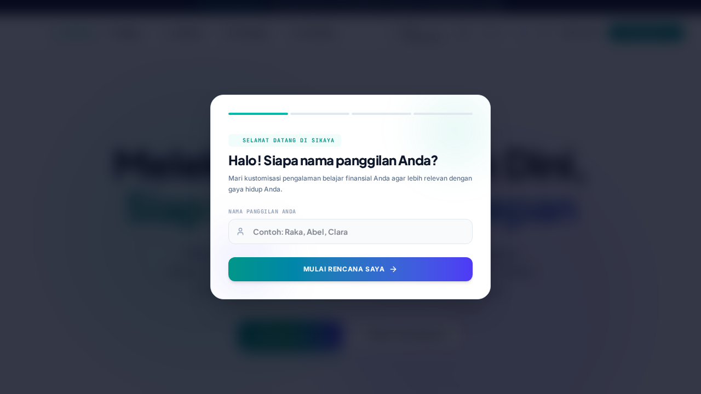

<div align="center">

# 💰 SiKaya
### Production-Hardened Multi-Asset Investment Education & Portfolio Analytics Platform

[](https://react.dev/)
[](https://www.typescriptlang.org/)
[](https://tailwindcss.com/)
[](https://firebase.google.com/)
[](https://ai.google.dev/)
[](https://vitest.dev/)
[](https://playwright.dev/)

<p align="center">
  <em>An interactive, enterprise-grade digital ecosystem bridging financial literacy with real-world multi-asset portfolio simulation.</em>
</p>



</div>

---

## 📌 Executive Summary

**SiKaya** is a comprehensive financial technology platform designed to elevate financial literacy through gamified simulation, real-time market insights, and interactive advisory. Built on top of **React 19**, **Express**, and **Firebase**, SiKaya provides users with realistic multi-asset portfolio management across Indonesian and global equities, crypto assets, bonds, and precious metals.

The platform has undergone rigorous production hardening, achieving high scores in security, performance, accessibility, and automated test coverage.

---

## ✨ Key Capabilities

- 📊 **Multi-Asset Portfolio Simulation:** Live-simulated trading and allocation tracking across Stocks, Cryptocurrency, Government Bonds, and Gold.
- 🎓 **Interactive Financial Literacy Academy:** Structured curriculum covering budgeting, risk profiles, compound interest mechanics, and market analysis with gamified XP & ranking tiers.
- 🤖 **AI Financial Assistant (Google Gemini):** Context-aware conversational AI that assists users in interpreting portfolio distributions and financial concepts without offering direct financial advice.
- 📑 **Dynamic Report Generation:** On-demand export of comprehensive financial statements and portfolio reports to **PDF** and **Excel** (`xlsx`, `jspdf`, `html2canvas`).
- ⚡ **Real-Time Market Caching:** Intelligent request coalescing and 30-second in-memory caching with a 5-minute stale-while-revalidate (SWR) fallback to maximize responsiveness.

---

## 🛡️ Enterprise Architecture & Hardening

SiKaya is engineered with defense-in-depth principles:

### 1. Zero-Trust Security & Access Control
- **Firestore Security Rules:** Mathematically secured rule definitions verified through Firebase Emulator (`@firebase/rules-unit-testing`). Client-side tampering of experience points (`xp`), user tier ranks, or literacy scores is blocked at the database engine level.
- **Strict Network Guardrails:** Full HTTP security headers orchestrated via `helmet`, CORS restrictions, and aggressive rate-limiting on sensitive AI and authentication endpoints.
- **Zod Data Validation:** End-to-end schema validation ensuring all incoming requests strictly conform to expected types.

### 2. High-Performance Front-End
- **Route-Level Code Splitting:** Implements React `lazy` and `Suspense` across views to guarantee instant first-contentful paint.
- **Dynamic Module Loading:** Bulky reporting libraries (`jspdf`, `xlsx`) are imported dynamically only upon explicit user download request.
- **Rollup Chunk Partitioning:** Vendor code separated into granular chunks (`vendor-react`, `vendor-motion`, `vendor-charts`) for optimal long-term browser caching.

### 3. Reliability & Observability
- **Request Tracing:** End-to-end tracking with `X-Request-ID` headers across all API exchanges.
- **PII Scrubbing:** Automated sanitization on structured JSON logging to eliminate accidental leaks of user credentials and keys.
- **Health Probes:** Built-in `/api/health` (liveness) and `/api/ready` (readiness) endpoints for orchestration environments.

---

## 🧪 Comprehensive Testing Suite

SiKaya features a multi-tiered automated testing pipeline:

| Test Scope | Tooling | Coverage / Target |
| :--- | :--- | :--- |
| **Unit Testing** | Vitest | Compound interest math, financial health algorithms, edge cases |
| **Integration Testing** | Supertest + Vitest | Express API routes, auth headers, rate-limit triggers |
| **Security Rules Testing** | `@firebase/rules-unit-testing` | Firestore isolation (unauthorized access rejection) |
| **End-to-End Testing** | Playwright | Full user journey, mobile & desktop viewports |
| **Accessibility (A11y)** | `@axe-core/playwright` | WCAG 2.1 compliance auditing |

Run tests locally:
```bash
# Run unit & integration tests
npm test

# Run tests with coverage report
npm run test:coverage

# Run Playwright E2E suites
npm run test:e2e
```

---

## 🚀 Getting Started

### Prerequisites
- **Node.js** `>= 20.0.0`
- **npm** or **pnpm**

### Installation
1. Clone the repository:
   ```bash
   git clone https://github.com/irsyadazaki77-beep/SiKaya.git
   cd SiKaya
   ```

2. Install dependencies:
   ```bash
   npm install
   ```

3. Set up environment variables:
   ```bash
   cp .env.example .env
   # Populate your Google Gemini API and Firebase keys
   ```

4. Launch the local development server:
   ```bash
   npm run dev
   ```
   Open [http://localhost:5173](http://localhost:5173) in your browser.

5. Production build:
   ```bash
   npm run build
   npm start
   ```

---

## 👨‍💻 Author

**Zaki Irsyada Putra**  
*Information Systems Undergraduate — Telkom University Surabaya*  
- 🌐 [Portfolio](https://irsyadazaki77-beep.github.io/portfolio/)
- 🐙 [GitHub: @irsyadazaki77-beep](https://github.com/irsyadazaki77-beep)
- ✉️ [irsyadazaki77@gmail.com](mailto:irsyadazaki77@gmail.com)

---
<sub>Licensed under the MIT License.</sub>
